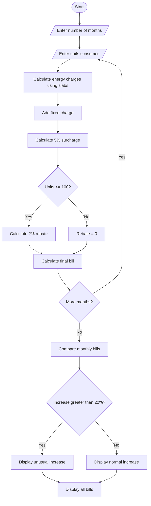

##Programme Statement

The aim of this program is to calculate household electricity bills using different electricity consumption slabs. It calculates the energy charges, fixed charges, surcharges and rebates. It also compares electricity bills across multiple months and identifies unusual increases in electricity consumption bills.

## Algorithm

1. Start the program.
2. Read the number of months.
3. Enter the electricity units consumed for each month.
4. Calculate the energy charges based on consumption slabs:
   - First 100 units – ₹1.50 per unit.
   - Next 100 units – ₹2.50 per unit.
   - Next 100 units – ₹4.00 per unit.
   - Above 300 units – ₹6.00 per unit.
5. Add a fixed charge of ₹50.
6. Calculate a 5% surcharge on the energy charge and fixed charge.
7. If consumption is 100 units or less, give a 2% rebate.
8. Calculate the final electricity bill.
9. Compare the current month's bill with the previous month's bill.
10. If the bill increases by more than 20%, display an unusual increase message.
11. Display the monthly electricity bills.
12. Stop the program.

##sample input
Enter number of months: 3

Month 1
Enter electricity units: 80

Month 2
Enter electricity units: 150

Month 3
Enter electricity units: 280
    P --> Q([Stop])
```
##sample output
Month 1
Energy Charge: 120.0
Fixed Charge: 50
Surcharge: 8.5
Rebate: 3.4
Total Bill: Rs. 175.1

Month 2
Energy Charge: 275.0
Fixed Charge: 50
Surcharge: 16.25
Rebate: 0
Total Bill: Rs. 341.25

Month 3
Energy Charge: 870.0
Fixed Charge: 50
Surcharge: 46.0
Rebate: 0
Total Bill: Rs. 966.0

Monthly Bill Comparison

Month 1 Bill: Rs. 175.1

Month 2 Bill: Rs. 341.25
Unusual Increase Detected!

Month 3 Bill: Rs. 966.0
Unusual Increase Detected!
