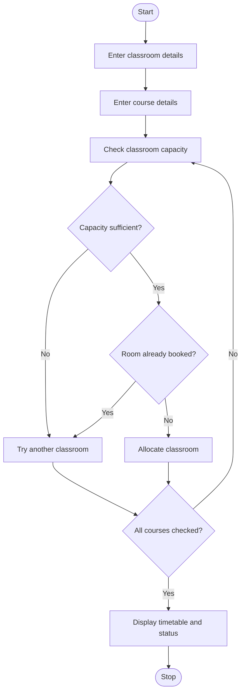

##Smart Classroom Timetable Allocation

## Program Statement

To develop a Python program that allocates courses to classrooms based on student strength and classroom capacity. The program uses lists and tuples to represent courses, rooms, and periods. It checks classroom capacity, detects room clashes, and verifies whether all courses can be accommodated.

## Algorithm
1. Start the program.
2. Read the number of classrooms and their capacities.
3. Store classroom details in a list of tuples.
4. Read the number of courses.
5. Enter each course name, number of students, and period.
6. Check each classroom for sufficient capacity.
7. Check whether the classroom is already occupied during that period.
8. If a suitable classroom is available, allocate it to the course.
9. Otherwise, display that the course cannot be allocated.
10. Display the final timetable and allocation status.
11. Stop.

## sample input

Enter number of classrooms: 2

Enter room name: Room A

Enter room capacity: 60

Enter room name: Room B

Enter room capacity: 40

Enter number of courses: 3

Enter course name: Python

Enter number of students: 50

Enter period: Morning

Enter course name: Java

Enter number of students: 35

Enter period: Morning

Enter course name: C

Enter number of students: 30

Enter period: Afternoon

##sample output

CLASSROOM TIMETABLE

Python -> Room A -> Morning

Java -> Room B -> Morning

C -> Room A -> Afternoon

Courses not allocated: []

All courses are accommodated.
