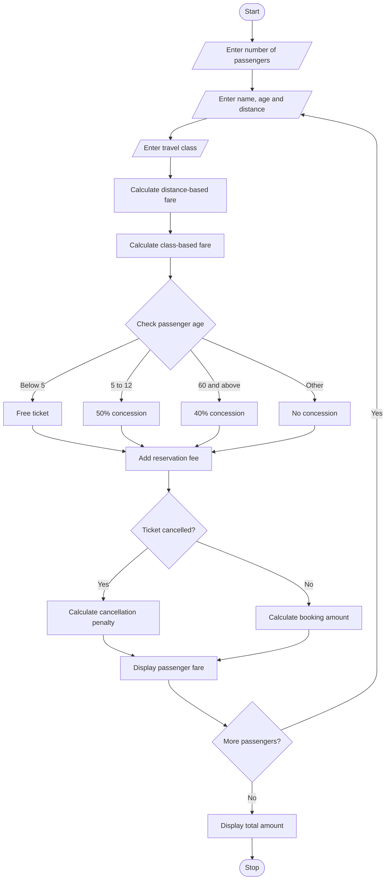

## Problem Statement
The aim of this program is to develop a Railway Fare and Reservation Calculator using Python. The program calculates railway ticket fares for multiple passengers based on distance travelled, travel class, age-based concessions, and reservation fees. It also calculates cancellation penalties when a passenger cancels a ticket. Finally, it displays the total fare for all passengers.

##Algorithm
1. Start the program.
2. Enter the number of passengers.
3. For each passenger, enter:
   - Passenger name.
   - Age.
   - Distance travelled in kilometres.
   - Travel class (Sleeper, AC 3 Tier or AC 2 Tier).
   - Ticket status (Booking or Cancellation).
4. Calculate the basic fare based on distance:
   - First 100 km – ₹1.00 per km.
   - Next 100 km – ₹1.50 per km.
   - Above 200 km – ₹2.00 per km.
5. Calculate the fare based on travel class:
   - Sleeper – 1 times basic fare.
   - AC 3 Tier – 2 times basic fare.
   - AC 2 Tier – 3 times basic fare.
6. Apply age-based concessions:
   - Below 5 years – Free ticket.
   - 5 to 12 years – 50% concession.
   - 60 years and above – 40% concession.
   - Other passengers – No concession.
7. Add a reservation fee of ₹40.
8. If the passenger cancels the ticket, calculate a cancellation penalty of 25% of the ticket fare.
9. Calculate the final amount.
10. Display each passenger's fare and the total amount.
11. Stop the program.


##Sample output

Enter number of passengers: 3

Passenger 1
Enter passenger name: Ravi
Enter age: 30
Enter distance in km: 150
Enter travel class: 1
Enter ticket status: 1

Passenger 2
Enter passenger name: Sita
Enter age: 10
Enter distance in km: 250
Enter travel class: 2
Enter ticket status: 1

Passenger 3
Enter passenger name: Kumar
Enter age: 30
Enter distance in km: 100
Enter travel class: 1
Enter ticket status: 2
```
##sample output


Ticket Booked Successfully
Passenger Name: Ravi
Travel Class: Sleeper
Ticket Fare: 175.0
Reservation Fee: 40
Final Amount: Rs. 215.0

Ticket Booked Successfully
Passenger Name: Sita
Travel Class: AC 3 Tier
Ticket Fare: 400.0
Reservation Fee: 40
Final Amount: Rs. 440.0

Ticket Cancelled
Cancellation Penalty: 25.0
Passenger Name: Kumar
Travel Class: Sleeper
Ticket Fare: 100
Final Amount: Rs. 25.0

Total Amount for All Passengers: Rs. 680.0
