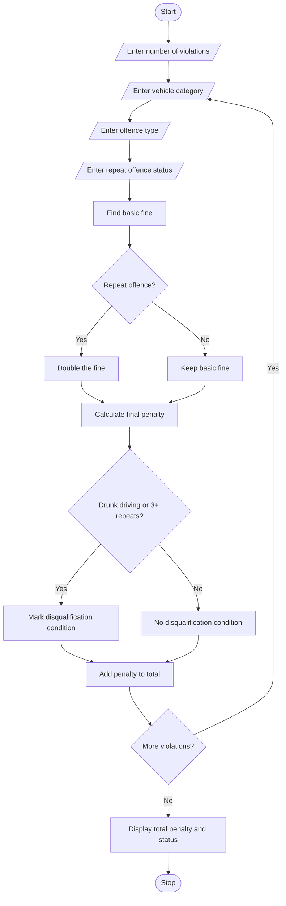

##Programme Statement
The aim of this program is to develop a Traffic Violation Penalty Calculator using Python. The program processes multiple traffic violations based on vehicle category, offence type and repeat-offence status. It calculates the fine amount using predefined penalty rules. It also identifies serious violations and checks whether the driver meets the disqualification conditions.

##Algorithm

1. Start the program.
2. Enter the number of traffic violations.
3. For each violation, enter:
   - Vehicle category (Two-wheeler, Four-wheeler or Heavy vehicle).
   - Offence type.
   - Repeat-offence status (Yes or No).
4. Calculate the basic fine based on the offence:
   - No helmet – ₹500.
   - Overspeeding – ₹1,000.
   - Signal jumping – ₹1,000.
   - Drunk driving – ₹10,000.
   - Driving without licence – ₹5,000.
5. Check whether the offence is repeated.
6. If it is a repeat offence, double the basic fine.
7. Calculate the final penalty.
8. Check disqualification conditions:
   - Drunk driving.
   - Three or more repeated violations.
9. Display the offence details and final penalty.
10. Calculate the total penalty for all violations.
11. Display the disqualification status.
12. Stop the program.

##Sample input
Enter number of violations: 3

Violation 1
Enter vehicle category: 1
Enter offence type: 1
Is it a repeat offence? (yes/no): no

Violation 2
Enter vehicle category: 2
Enter offence type: 2
Is it a repeat offence? (yes/no): yes

Violation 3
Enter vehicle category: 3
Enter offence type: 4
Is it a repeat offence? (yes/no): no

##sample output

Violation 1
Vehicle Category: 1
Offence: No Helmet
Final Fine: Rs. 500

Violation 2
Vehicle Category: 2
Offence: Overspeeding
Final Fine: Rs. 2000

Violation 3
Vehicle Category: 3
Offence: Drunk Driving
Final Fine: Rs. 10000

----- FINAL REPORT -----

Total Violations: 3
Total Fine: Rs. 12500

Driver Disqualification Condition: YES

    
