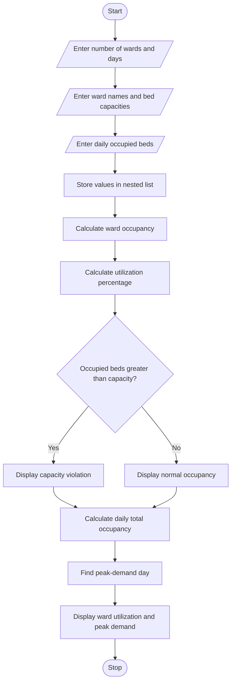

#Hospital Ward Occupancy Monitoring
##Programme Statement

The aim of this program is to develop a Hospital Ward Occupancy Monitoring System using Python. The program analyses bed occupancy counts in different hospital wards over multiple days using a nested list. It calculates the utilization percentage of each ward, detects capacity violations when occupied beds exceed the available capacity, and identifies the day with the highest patient demand.

##Algorithm

2. Algorithm
1. Start the program.
2. Enter the number of hospital wards.
3. Enter the number of days.
4. Enter the ward names and their total bed capacities.
5. Read the number of occupied beds in each ward for every day.
6. Store the occupancy values in a nested list.
7. Calculate the total occupied beds for each ward.
8. Calculate utilization percentage using the formula:
\[
Utilization = \frac{Occupied\ Beds}{Total\ Capacity}\times 100
\]

9. Check whether occupied beds exceed the ward capacity.
10. If occupancy exceeds capacity, display a capacity violation warning.
11. Calculate total occupied beds for each day.
12. Identify the day with the highest patient demand.
13. Display ward-wise utilization percentages and peak-demand information.
14. Stop the program.

#sample input
Enter number of wards: 3
Enter number of days: 3

Enter ward name: General
Enter total bed capacity: 50
Enter occupied beds on day 1: 40
Enter occupied beds on day 2: 45
Enter occupied beds on day 3: 55

Enter ward name: ICU
Enter total bed capacity: 20
Enter occupied beds on day 1: 15
Enter occupied beds on day 2: 18
Enter occupied beds on day 3: 20

Enter ward name: Emergency
Enter total bed capacity: 30
Enter occupied beds on day 1: 20
Enter occupied beds on day 2: 25
Enter occupied beds on day 3: 28

#sample output

----- WARD OCCUPANCY REPORT -----

Ward: General
Total Capacity: 50
Average Occupied Beds: 46.67
Utilization Percentage: 93.33 %

Capacity Violation on Day 3

Ward: ICU
Total Capacity: 20
Average Occupied Beds: 17.67
Utilization Percentage: 88.33 %

Ward: Emergency
Total Capacity: 30
Average Occupied Beds: 24.33
Utilization Percentage: 81.11 %

----- DAILY OCCUPANCY REPORT -----

Day 1 Total Occupied Beds: 75
Day 2 Total Occupied Beds: 88
Day 3 Total Occupied Beds: 103

Peak Demand Day: 3
Maximum Occupied Beds: 103

Monitoring Completed.
