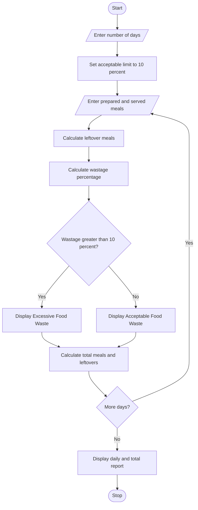

#Food Waste Monitoring System

##Programme Statement

The aim of this program is to develop a Food Waste Monitoring System using Python. The program compares the number of meals prepared, meals served and leftover meals across several days. It calculates the food wastage percentage for each day and identifies the days when food wastage exceeds the acceptable limit. It also displays the total food waste and helps to reduce unnecessary food preparation.

## Algorithm

1. Start the program.
2. Enter the number of days.
3. Set the acceptable food wastage limit to 10%.
4. For each day, enter:
   - Number of meals prepared.
   - Number of meals served.
   - Number of leftover meals.
5. Calculate leftover meals using the difference between prepared and served meals.
6. Calculate the wastage percentage using the formula:
\[
Wastage\ Percentage = \frac{Leftover\ Meals}{Prepared\ Meals}\times 100
\]

7. Compare the wastage percentage with the acceptable limit.
8. If wastage is greater than 10%, display "Excessive Food Waste".
9. Otherwise, display "Acceptable Food Waste".
10. Calculate total prepared meals, served meals and leftover meals.
11. Display the daily wastage report.
12. Stop the program.

##sample input

Enter number of days: 3

Day 1

Enter prepared meals: 100

Enter served meals: 90

Day 2

Enter prepared meals: 120

Enter served meals: 100

Day 3

Enter prepared meals: 80

Enter served meals: 76

##sample output

Day 1

Leftover Meals: 10

Wastage Percentage: 10.0 %

Acceptable Food Waste

Day 2

Leftover Meals: 20

Wastage Percentage: 16.67 %

Excessive Food Waste

Day 3

Leftover Meals: 4

Wastage Percentage: 5.0 %

Acceptable Food Waste

----- FOOD WASTE REPORT -----

Day 1

Prepared Meals: 100

Served Meals: 90

Leftover Meals: 10

Wastage: 10.0 %

Status: Acceptable

Day 2

Prepared Meals: 120

Served Meals: 100

Leftover Meals: 20

Wastage: 16.67 %
Status: Excessive Waste

Day 3

Prepared Meals: 80

Served Meals: 76

Leftover Meals: 4

Wastage: 5.0 %

Status: Acceptable

Total Prepared Meals: 300

Total Served Meals: 266

Total Leftover Meals: 34

Overall Wastage: 11.33 %

Food Waste Monitoring Completed.

