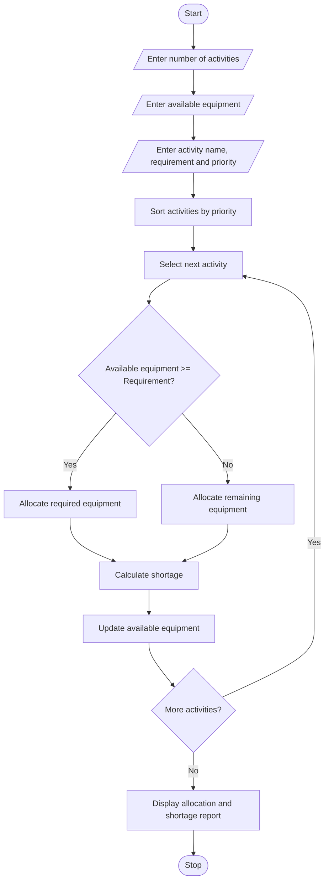

#Campus Resource Allocation Under Constraints

## Programme Statement
The aim of this program is to develop a Campus Resource Allocation System using Python. The program compares the equipment requirements of multiple campus activities with the available resources. It calculates the shortage of equipment and allocates available resources based on a specified priority order. It also displays the resources allocated to each activity and identifies activities that cannot receive their complete requirements.

## Algorithm

1. Start the program.
2. Enter the number of campus activities.
3. Enter the total available equipment.
4. For each activity, enter:
   - Activity name.
   - Equipment requirement.
   - Priority number.
5. Sort the activities according to priority.
6. Allocate available equipment to the highest-priority activity first.
7. Check whether sufficient equipment is available.
8. If sufficient equipment is available, allocate the required quantity.
9. Otherwise, allocate the remaining available equipment.
10. Calculate the shortage for each activity.
11. Update the remaining available equipment.
12. Display the allocated equipment and shortages.
13. Display the remaining equipment.
14. Stop the program.

##sample input

Enter number of activities: 3

Enter total available equipment: 100

Activity 1

Enter activity name: Coding Workshop

Enter required equipment: 50

Enter priority (1 = Highest): 1

Activity 2

Enter activity name: Sports Event

Enter required equipment: 40

Enter priority (1 = Highest): 2

Activity 3

Enter activity name: Cultural Fest

Enter required equipment: 30

Enter priority (1 = Highest): 3

##sample output

----- RESOURCE ALLOCATION REPORT -----

Activity: Coding Workshop

Priority: 1

Required Equipment: 50

Allocated Equipment: 50

Shortage: 0

Status: Fully Allocated

Activity: Sports Event

Priority: 2

Required Equipment: 40

Allocated Equipment: 40

Shortage: 0

Status: Fully Allocated

Activity: Cultural Fest

Priority: 3

Required Equipment: 30

Allocated Equipment: 10

Shortage: 20

Status: Partially Allocated

----- FINAL REPORT -----

Total Allocated Equipment: 100

Remaining Equipment: 0

Resource Allocation Completed.
    
