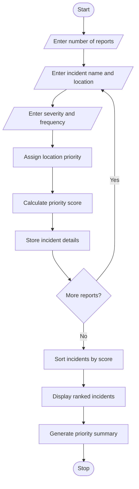

## Smart Campus Incident and Maintenance Prioritization

## Programme Statement

The aim of this program is to develop a Smart Campus Incident and Maintenance Prioritization System using Python. The program collects maintenance reports from different campus locations and classifies them based on severity, location and reported frequency. It assigns priority scores to incidents using predefined rules, ranks the incidents from highest to lowest priority and generates a summary to help the college management solve important problems first.

## Algorithm

1. Start the program.
2. Enter the number of maintenance reports.
3. For each report, enter:
   - Incident name.
   - Campus location.
   - Severity level (1 = Low, 2 = Medium, 3 = High).
   - Number of times reported.
4. Assign location priority:
   - Laboratory – 3 points.
   - Classroom – 2 points.
   - Other locations – 1 point.
5. Calculate the priority score using:
\[
Score = (Severity \times 10) + (Frequency \times 2) + Location\ Priority
\]

6. Store all incident details and priority scores in a list.
7. Sort the incidents in descending order of priority score.
8. Display the incidents from highest to lowest priority.
9. Display a priority summary.
10. Stop the program.

##sample input

Enter number of maintenance reports: 3

Incident 1

Enter incident name: Water Leakage

Enter campus location: Classroom

Enter severity: 2

Enter reported frequency: 3

Incident 2

Enter incident name: Electrical Problem

Enter campus location: Laboratory

Enter severity: 3

Enter reported frequency: 5

Incident 3

Enter incident name: Broken Chair

Enter campus location: Classroom

Enter severity: 1

Enter reported frequency: 2

##sample ouput

----- INCIDENT PRIORITY REPORT -----

Rank: 1

Incident: Electrical Problem

Location: Laboratory

Severity: 3

Frequency: 5

Priority Score: 43

Rank: 2

Incident: Water Leakage

Location: Classroom

Severity: 2

Frequency: 3

Priority Score: 28

Rank: 3

Incident: Broken Chair

Location: Classroom

Severity: 1

Frequency: 2

Priority Score: 16

----- PRIORITY SUMMARY -----

High Priority Cases: 1

Medium Priority Cases: 1

Low Priority Cases: 1

Highest Priority Incident: Electrical Problem

Maintenance Monitoring Completed.
    
