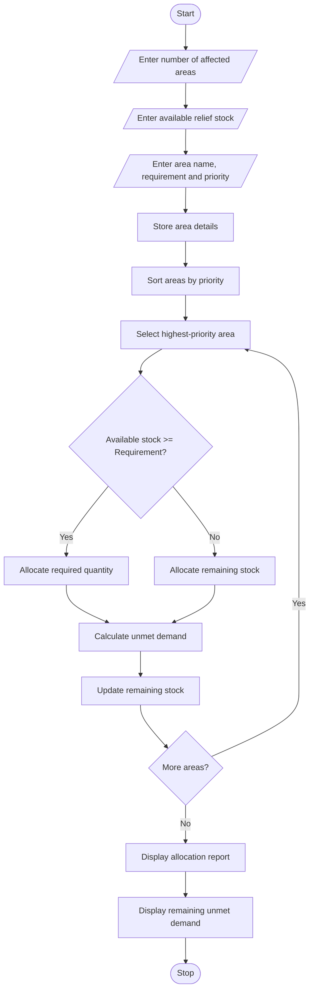

##Disaster Relief Supply Allocation

##Programme Statement

The aim of this program is to develop a Disaster Relief Supply Allocation System using Python. The program compares the available stock of relief materials with the requirements of different affected areas. It prioritizes urgent shortages and allocates limited supplies according to priority order. It also calculates the remaining unmet demand and displays the final allocation report.

## Algorithm

1. Start the program.
2. Enter the number of affected areas.
3. Enter the available stock of relief supplies.
4. For each area, enter:
   - Area name.
   - Required quantity of supplies.
   - Priority level (1 = Highest).
5. Store the area details in a list.
6. Sort the areas according to priority.
7. Select the highest-priority area.
8. Compare the required quantity with available stock.
9. If sufficient stock is available, allocate the required quantity.
10. Otherwise, allocate the remaining available stock.
11. Calculate the unmet demand.
12. Update the remaining stock.
13. Repeat the process for all areas.
14. Display allocated supplies and unmet demand.
15. Display the remaining stock.
16. Stop the program.

###sample input

Enter number of affected areas: 3

Enter total available relief supplies: 100

Area 1

Enter area name: Village A

Enter required supplies: 60

Enter priority: 1

Area 2

Enter area name: Village B

Enter required supplies: 50

Enter priority: 2

Area 3

Enter area name: Village C

Enter required supplies: 40

Enter priority: 3

##sample output

----- RELIEF ALLOCATION REPORT -----

Area: Village A

Priority: 1

Required Supplies: 60

Allocated Supplies: 60

Unmet Demand: 0

Status: Fully Supplied

Area: Village B

Priority: 2

Required Supplies: 50

Allocated Supplies: 40

Unmet Demand: 10

Status: Partially Supplied

Area: Village C

Priority: 3

Required Supplies: 40

Allocated Supplies: 0

Unmet Demand: 40

Status: Partially Supplied

----- FINAL REPORT -----

Total Allocated Supplies: 100

Total Unmet Demand: 50

Remaining Stock: 0

Disaster Relief Allocation Completed.
